<p align="center">
  
</p>

<h1 align="center">VoronDeck</h1>

<p align="center"><strong>A customizable touchscreen interface for Klipper 3D printers</strong></p>

<p align="center"><a href="README.md">Русский</a> · <strong>English</strong></p>

<p align="center">
  <a href="https://github.com/Redaktor-clok/VoronDeck/releases/latest"></a>
  <a href="LICENSE"></a>
  
  
  
</p>

Temperatures, fans, materials and print controls in one place. Build your home screen from the tiles you need, choose a theme and palette, and use your display in landscape or portrait orientation.

VoronDeck develops the interface for Voron and NEMESIS projects: simplified spool views, separate tabs for multiple AMS units with up to 24 channels, material profiles, and filament tracking with Spoolman or local records. Available calibrations follow your printer configuration. Power-loss recovery is integrated through the separate VoronDeck Recovery plugin.

**Based on [HelixScreen](https://github.com/prestonbrown/helixscreen), created by Preston Brown and the project's contributors.** Thank you for the open-source foundation. VoronDeck is an independent modification with its own visual design, interface changes and additional features. Author and license notices are preserved in the [credits](docs/VORONDECK-CREDITS.md).

[Installation](#installation) · [Features](#features) · [Multi-material](#multi-material) · [Updates](#updates) · [Getting started (RU)](docs/VORONDECK-GETTING-STARTED.md) · [Roadmap and tests](.github/actions/docs/ROADMAP.md) · [Actions](.github/actions/docs/DEVELOPMENT.md)

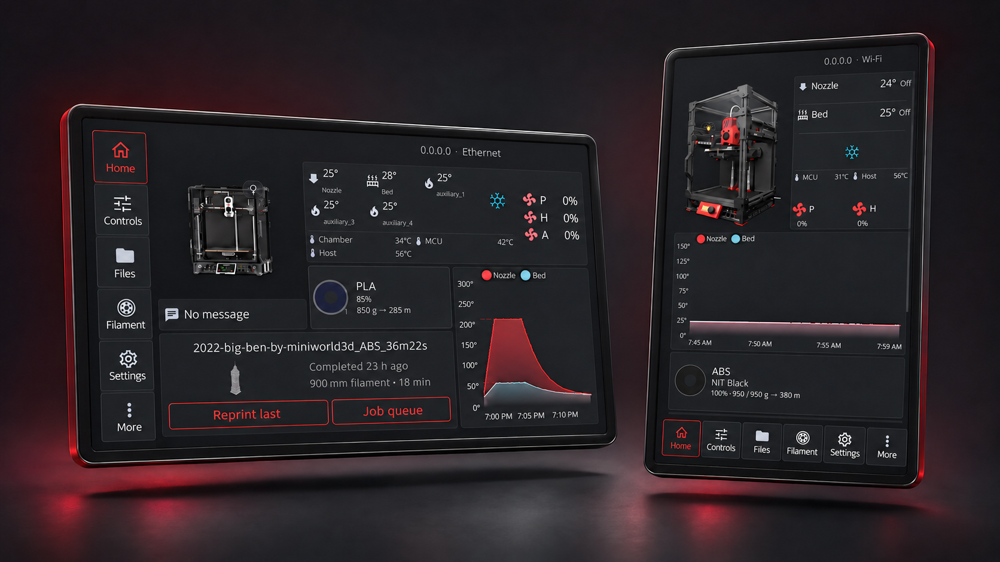

> **VoronDeck 1.0.1 — stable release.** A ready-to-install package is available for Linux `aarch64` with glibc 2.30 or newer. The main repository and stable updates are public; the beta channel remains private.

## Features

| Area | Features |
| --- | --- |
| Home screen | Heaters, sensors, fans, temperature charts, spools and the last print. Choose, resize and arrange tiles. |
| Controls | Movement, heating, cooling and printer-supported calibrations, including PID and bed screw adjustment. |
| Printing | File selection and preview, pause, cancel, fine tuning and object exclusion when supported by the configuration and file. |
| Filament | Material profiles, temperatures, loading and unloading, an external spool or a compatible multi-material system. |
| Appearance | Themes, color palettes, light and dark modes, landscape and portrait layouts. |
| Setup | First-run wizard, Moonraker connection, printer image selection and placement of controls on the image. |
| Updates | Version checks on the screen and a VoronDeck component in Moonraker's update manager. |

Available devices and calibrations depend on the Klipper configuration. A chamber temperature sensor alone does not provide chamber heating control.

## A home screen for your workflow

Add the widgets you need, resize them and arrange the tiles. Choose which heaters, sensors and fans to display. Show heaters as large icons or as a scrolling list.

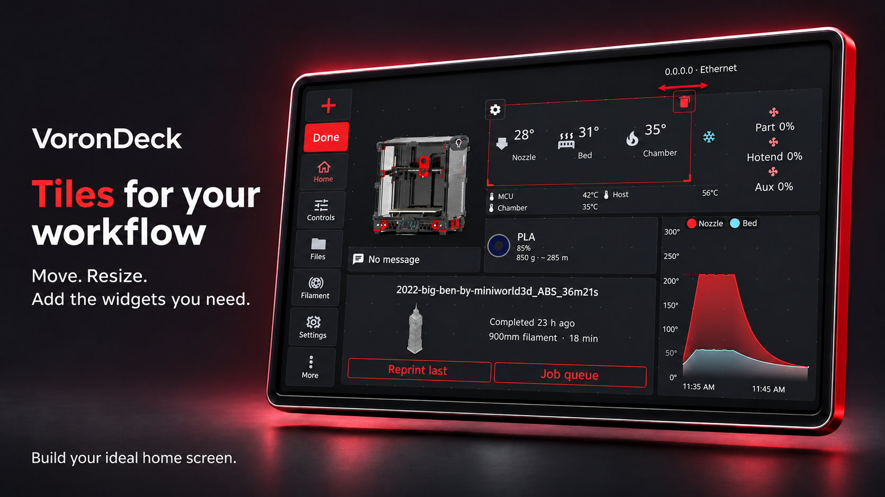

## Your screen. Your style.

Choose a theme and palette, preview the colors and apply your preferred look. The interface adapts to landscape and portrait displays.

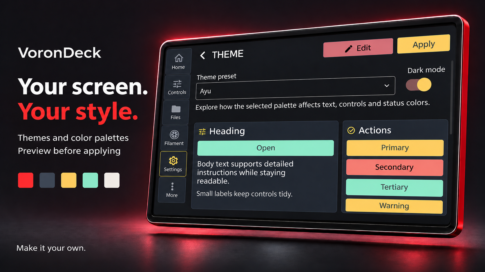

## Multi-material

Use an external spool or several filament systems in one interface. Compatible integrations include AFC and Happy Hare.

The interface supports configurations with **up to 24 channels**. Each connected AMS has its own tab, with continuous spool numbering across units. A single 8- or 16-channel system stays in one tab. Scroll when the spools do not fit on the screen.

The connected system and its configuration determine the actual channel limit. The images below illustrate example layouts.

### 4 colors · one AMS

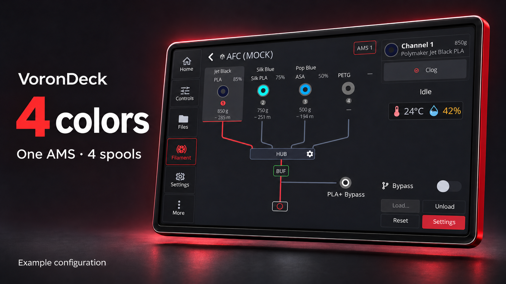

### 8 colors · one AMS

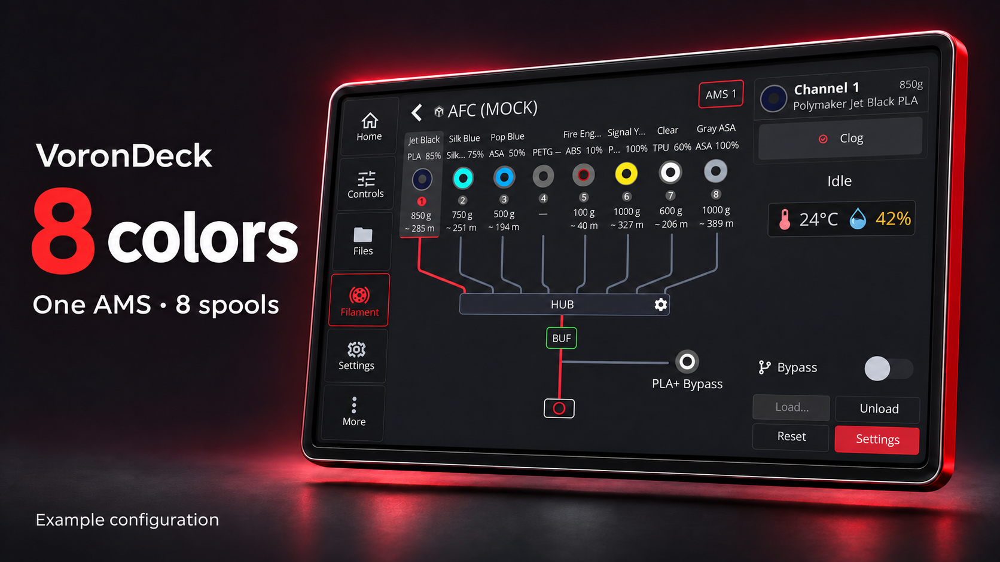

### 12 colors · three AMS units

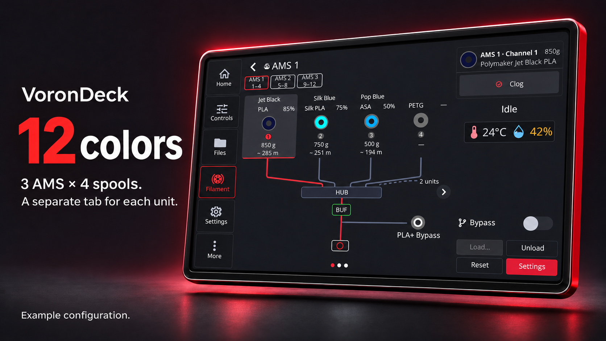

### 16 colors · four AMS units

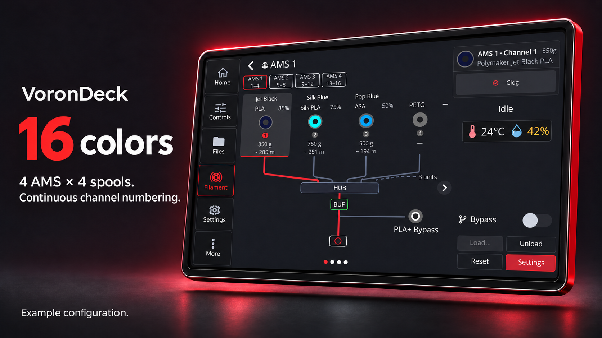

### 24 colors · six AMS units

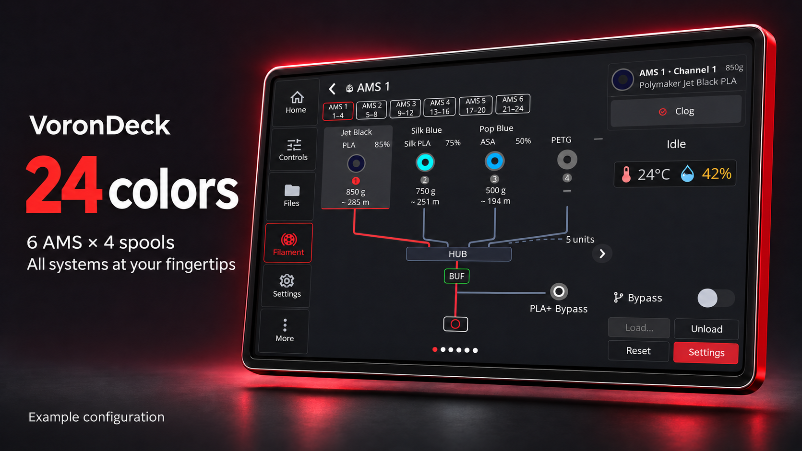

### Switching between systems

Switch AMS tabs to see that unit's spools, selected channel and feed status.

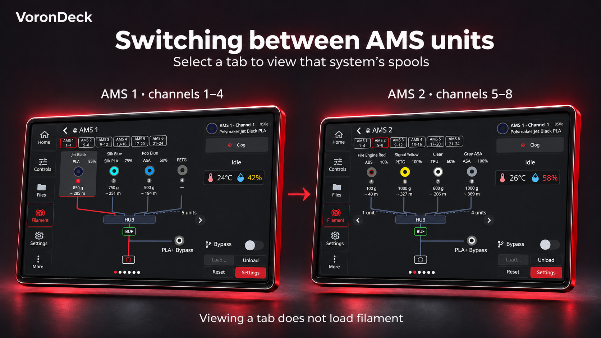

## Filament remaining

### With Spoolman

Connect Spoolman for spool information and remaining material. The color, material and ring fill help you see how much filament is available.

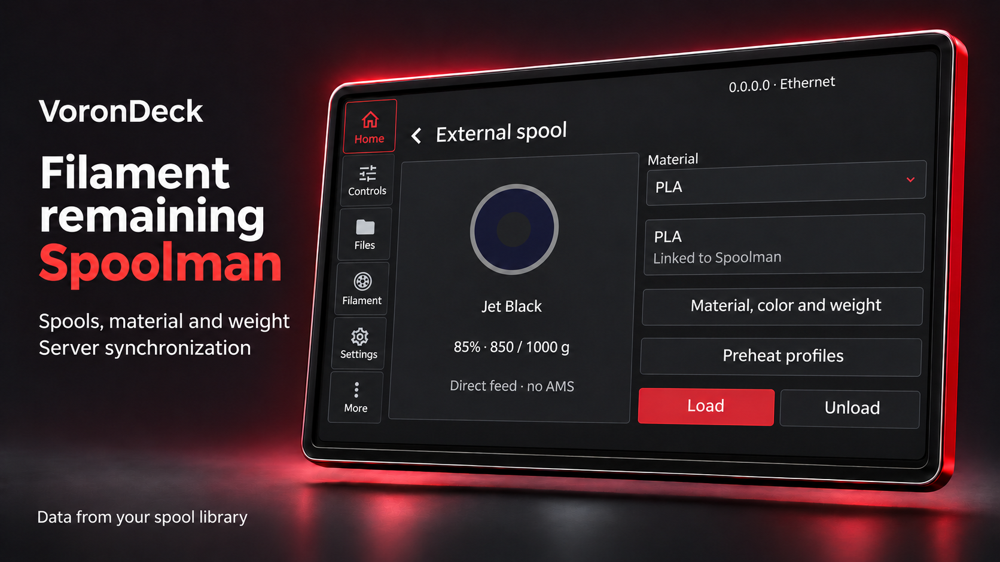

### Without Spoolman

Keep local records of material, color and filament weight without a separate Spoolman server. Remaining filament is shown as a percentage and in grams; length is calculated from material properties. This is calculated tracking, not a measurement from built-in scales.

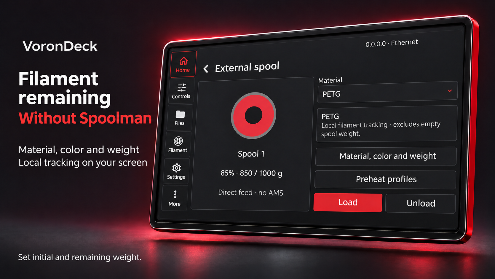

## Print recovery

**VoronDeck Recovery** is a separate power-loss recovery plugin. When it is installed and configured, the screen lets you enable or disable checkpoint saving and check for component updates.

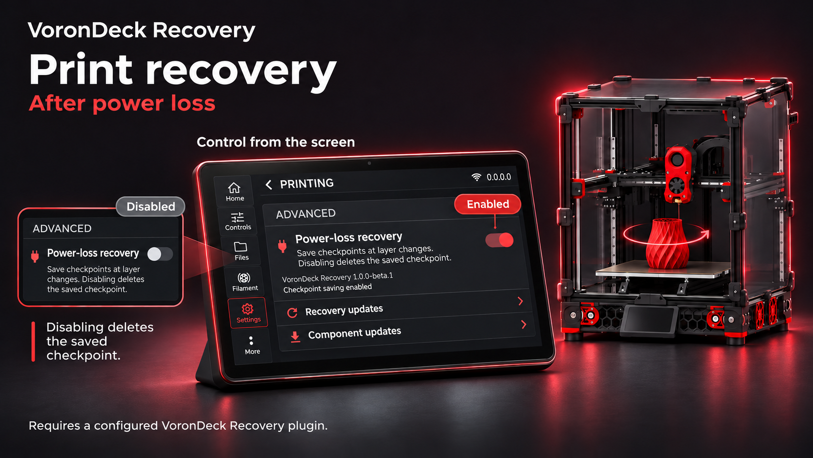

The plugin is installed separately and also requires access during beta testing. Whether a print can resume depends on its saved checkpoint and the printer's state after power loss. Check the machine position and the printed part before resuming.

## Installation

### Requirements

- A Linux host with working Klipper and Moonraker, accessible over SSH.
- A touchscreen with display output and touch input configured in Linux.
- Git, Python 3.9 or newer, and a printer user with `sudo` access.
- **64-bit ARM (`aarch64`), glibc 2.30 or newer, and libstdc++ with `GLIBCXX_3.4.26` or newer.** The installer checks other system libraries. Ready-to-install packages for `armv7`, `x86_64` and musl are not yet published.

The installer supports systemd and OpenRC service management. Compatibility is checked during installation.

### Four commands

Connect to the printer host over SSH as your regular user, then run:

```sh
cd ~
git clone https://github.com/Redaktor-clok/VoronDeck.git VoronDeck
cd ~/VoronDeck
./install.sh
```

Run the installer without `sudo`; it requests elevated permissions when needed. Finish any print, turn off the heaters and wait for the printer to be idle before installing.

Choose one of the installer options:

1. **Install with autostart** — replace the current screen at system startup.
2. **Run for testing** — switch screens now without changing autostart.
3. **Prepare files** — keep the current screen running.

Choose the installer language first: **Русский** or **English**. Menus, confirmations and progress messages use the selected language. You can also specify it directly: `./install.sh --language en` or `./install.sh --language ru`.

Preview of the console installer messages. Terminal appearance depends on your SSH client.

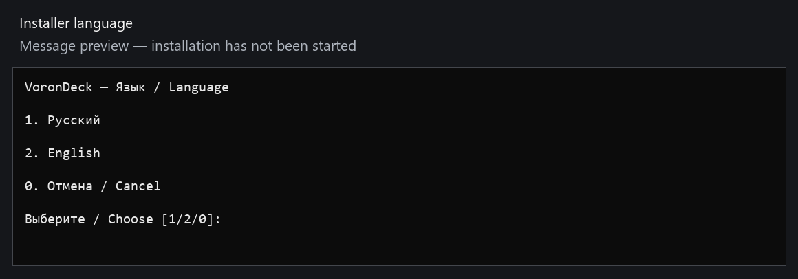

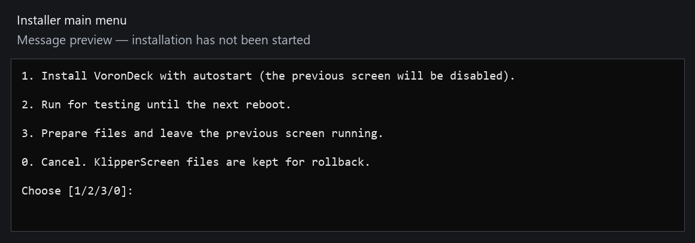

Before switching screens, the installer asks for confirmation. Enter `y` to continue, or `n` / Enter to decline the switch.

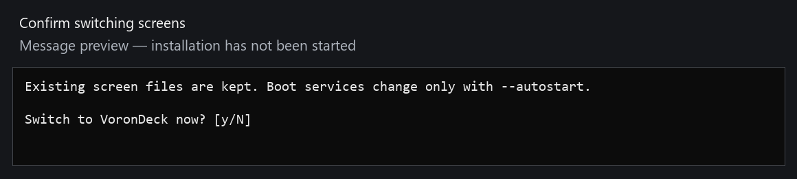

The installer checks the package and its checksum, offers to install missing libraries and preserves the previous screen's files, including KlipperScreen. Switching screens stops the previous screen's active service. Activation also configures VoronDeck in Moonraker's update manager.

If `~/VoronDeck` already exists, do not clone over it. Use the update manager for an installed screen.

### First run

Choose the language and orientation, then check touch input and the Moonraker connection. Review detected devices, select a printer image and theme. Optional checks and calibrations can be skipped and opened later from Controls.

See the [getting started guide (Russian)](docs/VORONDECK-GETTING-STARTED.md).

## Updates

Check versions from the screen's update settings or Moonraker's update manager in your printer's web interface. The installer adds VoronDeck as a separate component.

- **Stable channel:** public VoronDeck repository; installation and updates require no GitHub key.
- **Beta channel:** private VoronDeck-beta repository, with SSH-key access for testers.
- **VoronDeck Recovery:** a separate component with separate access during closed testing.

Update components while the printer is idle. Installing the screen does not automatically grant beta access.

---

Banners are presentation renders based on the interface; the depicted display housings are illustrative.

© 2026 VoronDeck. Licensed under [GPL-3.0](LICENSE). [Components and author credits](docs/VORONDECK-CREDITS.md).
