<p align="center">
  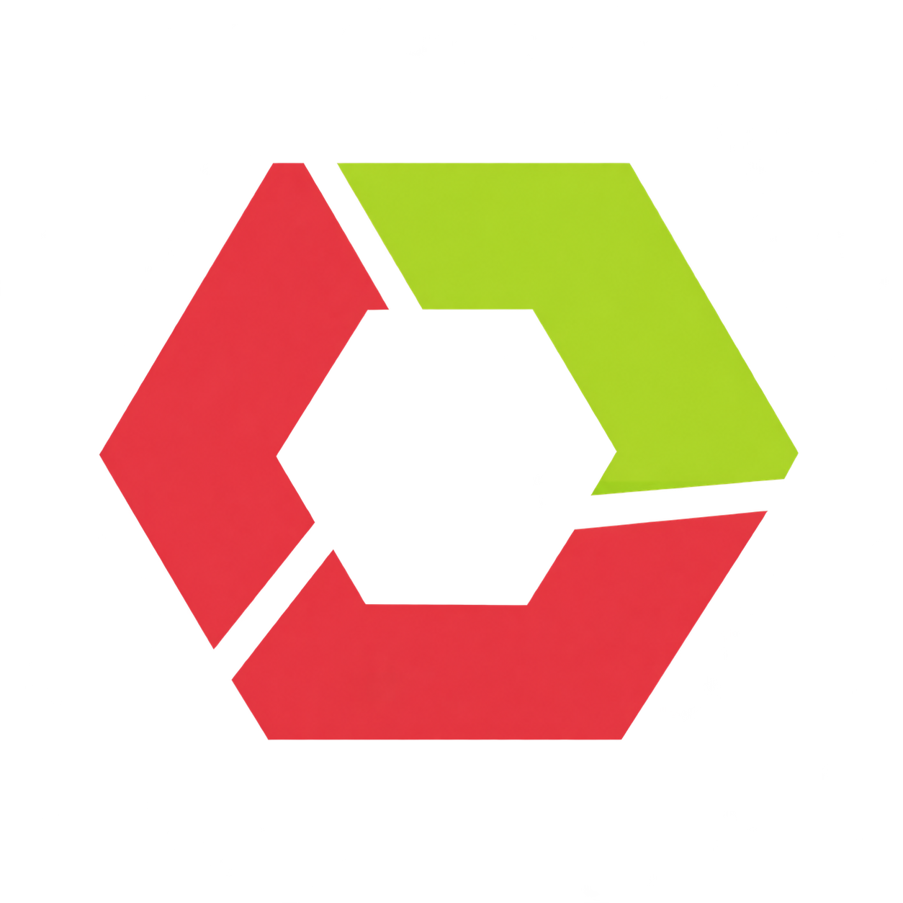
</p>

<h1 align="center">VoronDeck</h1>

<p align="center"><strong>Настраиваемый сенсорный интерфейс для 3D-принтеров с Klipper</strong></p>

<p align="center"><strong>Русский</strong> · <a href="README.en.md">English</a></p>

<p align="center">
  <a href="https://github.com/Redaktor-clok/VoronDeck/releases/latest"></a>
  <a href="LICENSE"></a>
  
  
  
</p>

Температуры, вентиляторы, материалы и управление печатью — на одном экране. Соберите главную страницу из нужных плиток, выберите тему и палитру, расположите дисплей горизонтально или вертикально.

VoronDeck развивает интерфейс под проекты Voron и NEMESIS: упрощённое отображение катушек, несколько AMS с отдельными вкладками и до 24 каналов, профили материалов и учёт остатка пластика со Spoolman или локально. Доступные калибровки подбираются по конфигурации принтера. Для восстановления после отключения питания предусмотрена интеграция с отдельным плагином VoronDeck Recovery.

**Основа проекта — [HelixScreen](https://github.com/prestonbrown/helixscreen), созданный Preston Brown и участниками проекта.** Спасибо авторам за открытую основу. VoronDeck — самостоятельная модификация с собственным оформлением, изменениями интерфейса и дополнительными возможностями. Сведения об авторах и лицензиях сохранены в [разделе благодарностей](docs/VORONDECK-CREDITS.md).

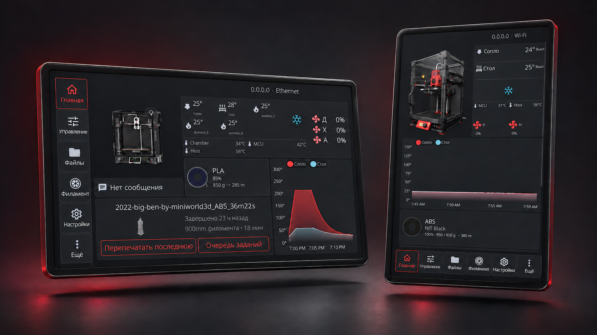

[Установка](#установка) · [Возможности](#возможности) · [Мультифиламент](#мультифиламент) · [Обновления](#обновления) · [Начало работы](docs/VORONDECK-GETTING-STARTED.md)

> **VoronDeck 1.0.1 — стабильный выпуск.** Готовый пакет доступен для Linux `aarch64` с glibc 2.30 или новее. Основной репозиторий и стабильные обновления открыты; бета-канал остаётся закрытым.

## Возможности

| Раздел | Что доступно |
| --- | --- |
| Главный экран | Нагреватели, датчики, вентиляторы, графики температур, катушки и последнее задание. Выбор состава, размера и расположения плиток. |
| Управление | Перемещения, нагрев, охлаждение и доступные принтеру калибровки, включая PID и настройку стола по винтам. |
| Печать | Выбор файла и предпросмотр, пауза, отмена, тонкая настройка и исключение объектов при поддержке конфигурацией и файлом. |
| Филамент | Профили материалов, температуры, загрузка и выгрузка, внешняя катушка или совместимая мультифиламентная система. |
| Внешний вид | Темы, цветовые палитры, светлый и тёмный режимы, горизонтальная и вертикальная ориентации. |
| Настройка | Мастер первого запуска, подключение к Moonraker, выбор изображения принтера и размещение узлов на нём. |
| Обновления | Проверка версии на экране и компонент VoronDeck в менеджере обновлений Moonraker. |

Состав доступных устройств и калибровок зависит от конфигурации Klipper. Подключение датчика температуры камеры само по себе не добавляет управление её нагревом.

## Главный экран под ваши задачи

Добавляйте нужные виджеты, меняйте размеры и расположение плиток. Выбирайте отображаемые нагреватели, датчики и вентиляторы. Нагреватели можно показывать крупными значками или прокручиваемым списком.

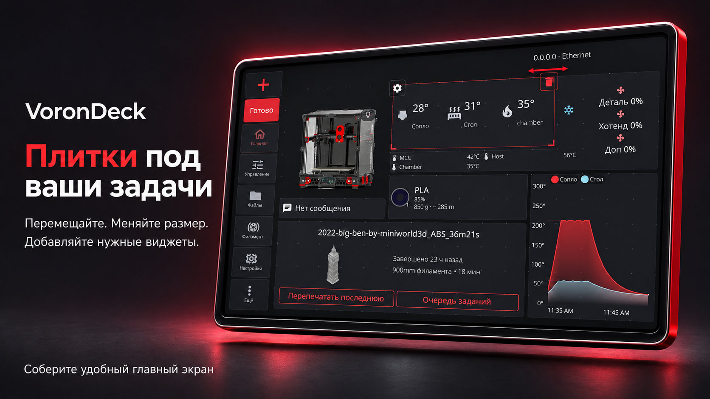

## Ваш экран. Ваш стиль.

Выбирайте тему и палитру, оценивайте цвета в предпросмотре и применяйте понравившийся вариант. Интерфейс адаптируется к горизонтальному и вертикальному расположению дисплея.

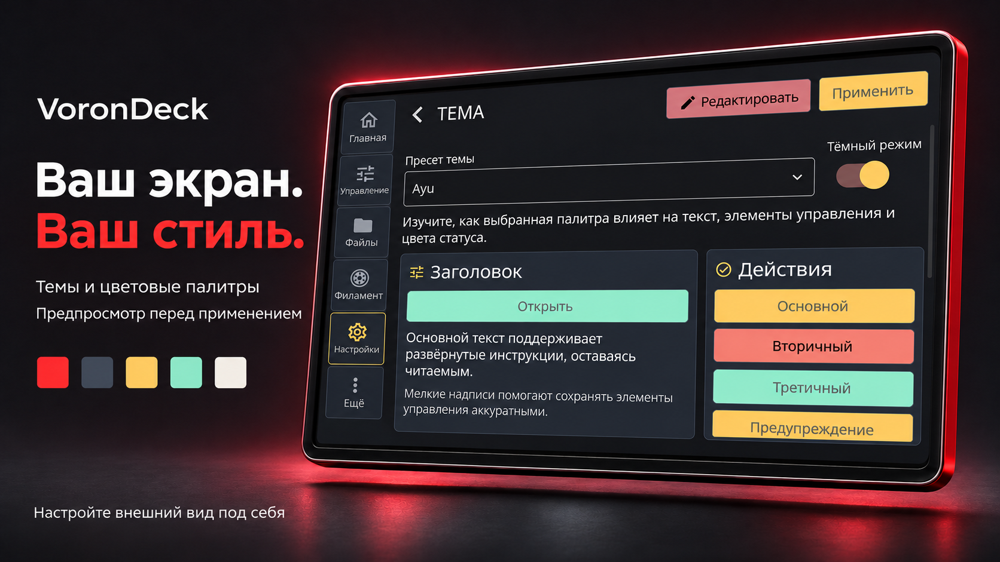

## Мультифиламент

Внешняя катушка или несколько систем подачи — в одном интерфейсе. Поддерживаются интеграции с совместимыми системами, включая AFC и Happy Hare.

Интерфейс рассчитан на конфигурации **до 24 каналов**. Каждая подключённая AMS получает свою вкладку, нумерация катушек продолжается между системами. Одна система на 8 или 16 каналов остаётся в одной вкладке. Если катушки не помещаются, доступна прокрутка.

Предельное количество каналов определяется подключённой системой и её конфигурацией. Ниже показаны примеры компоновки.

### 4 цвета · одна AMS

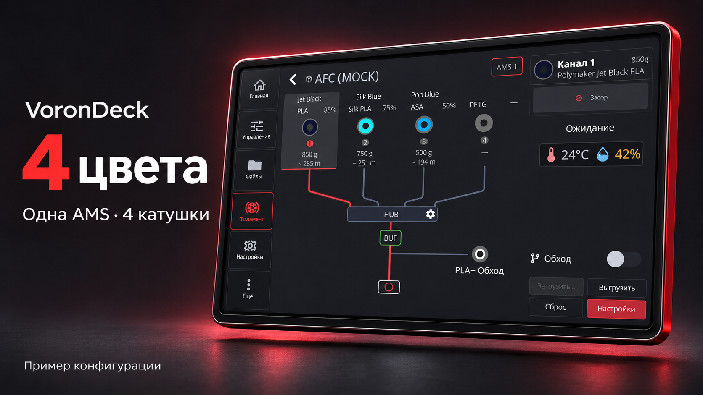

### 8 цветов · одна AMS

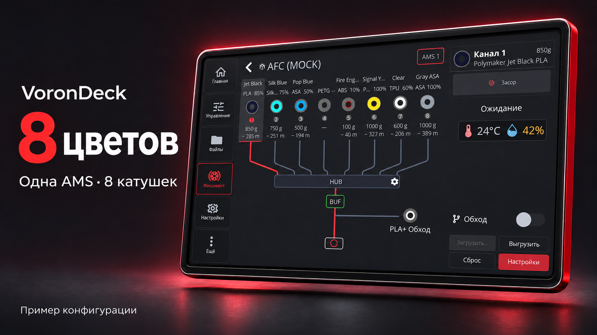

### 12 цветов · три AMS

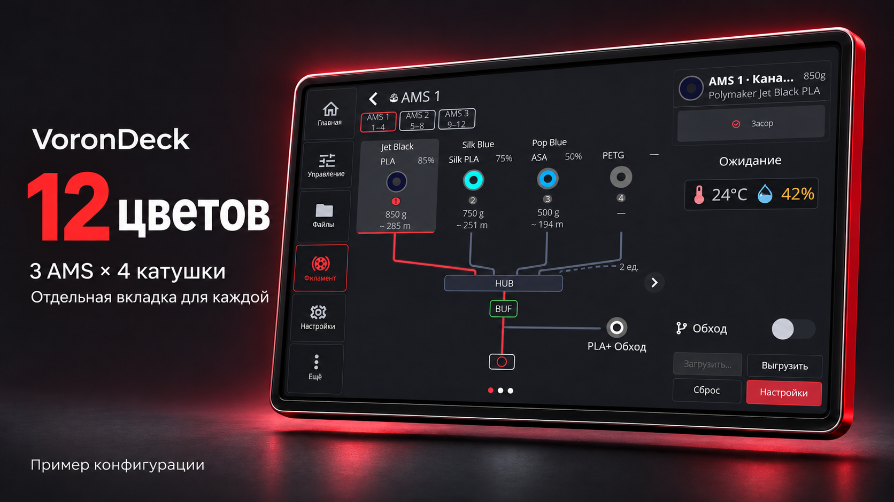

### 16 цветов · четыре AMS

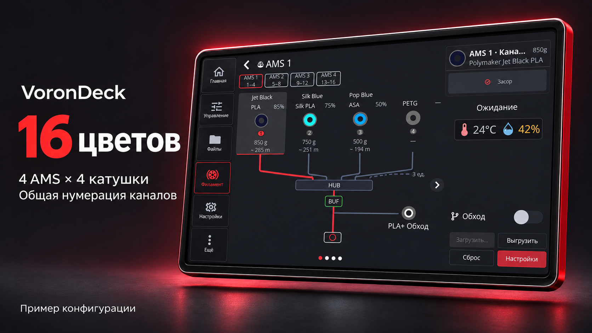

### 24 цвета · шесть AMS

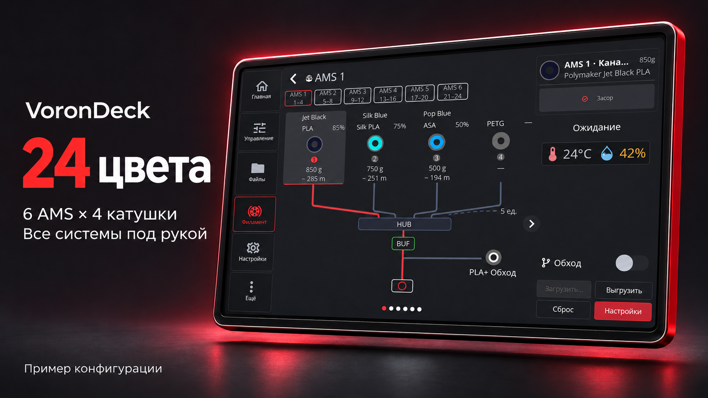

### Переключение между системами

Переключайтесь между вкладками AMS, чтобы видеть её катушки, выбранный канал и состояние подачи.

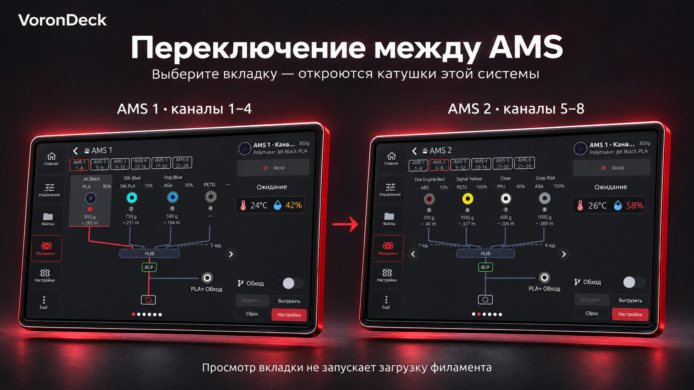

## Остаток пластика

### Со Spoolman

Используйте подключённый Spoolman для данных о катушке и остатке материала. Цвет, материал и заполнение кольца помогают быстро оценить запас пластика.

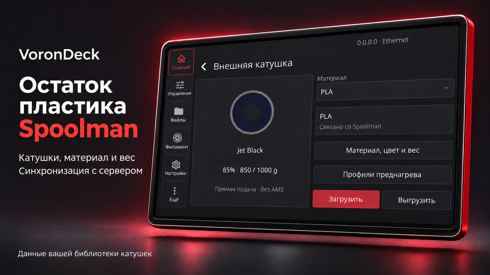

### Без Spoolman

Ведите локальный учёт: задавайте материал, цвет и вес пластика без отдельного сервера Spoolman. Остаток отображается в процентах и граммах; длина рассчитывается по параметрам материала. Это расчётный учёт, а не измерение встроенными весами.

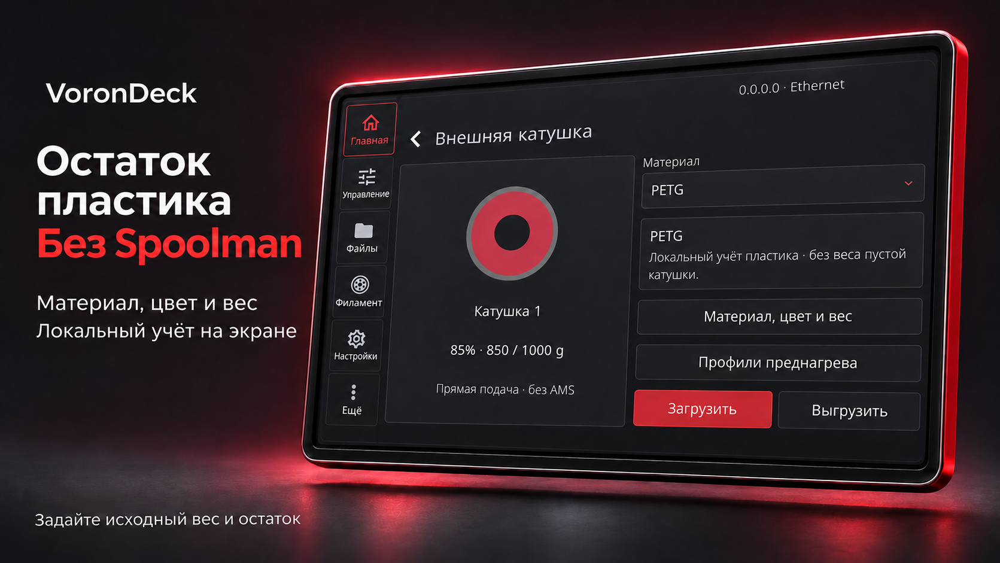

## Восстановление печати

**VoronDeck Recovery** — отдельный плагин восстановления после отключения питания. При установленном и настроенном плагине экран позволяет включать и выключать сохранение контрольных точек и проверять обновления компонента.

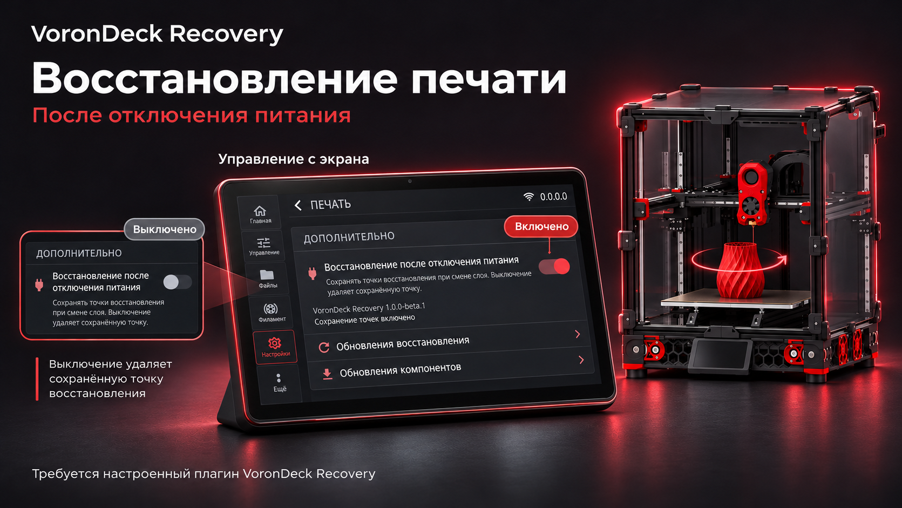

Плагин устанавливается отдельно и в период бета-тестирования также требует доступа. Возможность продолжения конкретной печати зависит от сохранённой точки и состояния принтера после отключения. Перед продолжением нужно проверить положение механики и сохранность детали.

## Установка

### Что потребуется

- Linux-хост с работающими Klipper и Moonraker, доступный по SSH.
- Сенсорный дисплей с настроенными в Linux выводом изображения и вводом касаний.
- Git, Python 3.9 или новее и пользователь принтера с доступом к `sudo`.
- **64-битная ARM-система (`aarch64`), glibc 2.30 или новее и libstdc++ с `GLIBCXX_3.4.26` или новее.** Установщик проверяет остальные системные библиотеки. Для `armv7`, `x86_64` и musl готовые пакеты пока не опубликованы.

Установщик поддерживает управление службами через systemd и OpenRC. Совместимость конкретной системы проверяется при установке.

### Четыре команды

Подключитесь по SSH к хосту принтера под обычным пользователем и выполните:

```sh
cd ~
git clone https://github.com/Redaktor-clok/VoronDeck.git VoronDeck
cd ~/VoronDeck
./install.sh
```

Запускайте установщик без `sudo`: права для необходимых действий он запросит сам. Перед установкой завершите печать, выключите нагреватели и дождитесь состояния простоя.

В меню выберите:

1. **Установить с автозапуском** — VoronDeck заменит текущий экран при запуске системы.
2. **Запустить для проверки** — переключить экран сейчас, не меняя автозапуск.
3. **Подготовить файлы** — оставить текущий экран работающим.

Установщик проверяет пакет и его контрольную сумму, предлагает установить недостающие библиотеки и сохраняет файлы прежнего экрана, включая KlipperScreen. При переключении активная служба прежнего экрана останавливается. После активации настраивается компонент обновлений VoronDeck в Moonraker.

Если папка `~/VoronDeck` уже существует, не клонируйте поверх неё: для установленного экрана используйте менеджер обновлений.

### Первый запуск

Выберите язык и ориентацию, проверьте касания и подключение к Moonraker. Затем проверьте найденные устройства, выберите изображение принтера и тему. Необязательные проверки и калибровки можно пропустить и открыть позже из раздела «Управление».

Подробнее — в [кратком руководстве по началу работы](docs/VORONDECK-GETTING-STARTED.md).

## Обновления

Проверяйте версию в разделе обновлений на экране или в менеджере обновлений Moonraker через веб-интерфейс принтера. Установщик добавляет VoronDeck как отдельный компонент.

- **Стабильный канал:** открытый основной репозиторий VoronDeck; установка и обновления без ключа GitHub.
- **Бета-канал:** приватный VoronDeck-beta, доступ для участников тестирования по SSH-ключу.
- **VoronDeck Recovery:** отдельный компонент и отдельный доступ на время закрытого тестирования.

Обновляйте компоненты вне печати. Доступ к бета-каналу не предоставляется автоматически при установке экрана.

---

Баннеры — презентационные рендеры на основе интерфейса; изображённые корпуса экранов иллюстративны.

© 2026 VoronDeck. Лицензия проекта — [GPL-3.0](LICENSE). [Сведения о компонентах и авторах](docs/VORONDECK-CREDITS.md).
